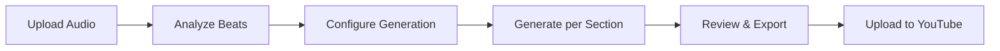

---
tags:
  - index
  - knowledge-library
  - music-video
  - production
aliases:
  - Knowledge Library Index
  - Music Video Knowledge Base
  - Production Reference
cssclasses:
  - knowledge-index
date: 2026-09-30
---

# 📚 Knowledge Library Index

> [!info] Purpose
> Centralized knowledge hub for AI agents and creators to produce compelling music videos for YouTube.
> Built for the Native Media AI Studio — a full-stack AI music video creation suite.

> [!tip] For AI Agents
> This vault is machine-readable. All documents use plain markdown with YAML frontmatter.
> Link between documents using wiki-links for cross-referencing.

---

## 🗂️ Library Structure

### 🎬 Production Pipeline (Workflow & Creative)

- [[music-video-production|🎵 Music Video Production Guide]] — Complete production workflow from audio upload to final export
- [[youtube-optimization|📺 YouTube Optimization]] — Platform-specific optimization for reach and engagement
- [[audio-reactive-production|🎧 Audio-Reactive Production]] — Audio → visual mapping, beat sync
- [[audio-reactive-visualization-2026-11|🔬 Audio-Reactive Visualization 2026-11]] — Research update: onset-detection constants, latency/clock discipline, Canvas2D perf budgets, band→parameter craft for T-VIZ-16–24 (NEW 2026-11-05)
- [[a1-a6-media-pipeline-tooling-2026|🧰 A1–A6 Media-Pipeline Tooling Map]] — Concrete tooling for the six adopted backlog items: music brain, cost meter, beat-quantized assembler, lyric/Canvas products, stem-reactive viz, model routing (NEW 2026-09-29)
- [[stem-system-evaluation-2026|🎛️ Stem System Evaluation 2026]] — Full audit of the per-stem pipeline: separation, API, frontend mixer, viz integration, bugs, and recommended fix sequence (NEW 2026-09-30)
- [[ai-music-mastering-stems-2026|🎚️ Mastering & Stem Splitting for AI Music 2026]] — LUFS/true-peak targets, the AI-defect chain (mud/fizz/side fog), Demucs quality knobs, and where stems do and don't help (NEW 2026-10-02)
- [[prompt-engineering|✍️ Prompt Engineering]] — Effective prompts + repair/versioning workflow
- [[character-animation-2026-summer-synthesis|🎭 Character Animation 2026 — Summer Synthesis]] — Story-first puppet, beatPhase sync, performance-driven
- [[silhouette-character-animation|🎭 Silhouette Character Animation]] — Character rigging & motion
- [[character-driven-visualization-research|🔬 Character-Driven Visualization]] — Character research
- [[browser-character-pipeline-research-2026|🦴 Browser Character Pipeline — Research Agenda]] — The 11 unresearched engineering categories between character design and a rendered browser character: sourcing, auto-rigging, the house skeleton, retargeting, beat-mapped blending, character textures/KTX2, skinned LOD, mixer runtime, pose-pass encoding (NEW 2026-11-06)
- [[browser-character-pipeline-verdicts-2026|✅ Browser Character Pipeline — Verdicts]] — The agenda answered: hybrid sourcing, HouseRig_v1 (49/61 bones), retarget + beat architecture, KTX2/single-material rules, runtime + disposal — distilled from an external research report and corrected against the studio's budgets (NEW 2026-11-06)
- [[media-anti-patterns-audit-2026|🚫 Media Anti-Patterns — Audit]] — Measured verdict: the library teaches generation capability and almost no slop-avoidance (17 of 49 media docs carry any avoid-language; the 3 ComfyUI workflows ship positive-only adjective stacks with no negatives); the canonical anti-patterns doc + pointers + surface fixes are T-VID-25 (NEW 2026-11-07)
- [[media-anti-patterns-2026|🚫 Media Anti-Patterns — The Canon]] — The single-source slop list for all media work: slop as specification failure, the six-point brief discipline, defect-vs-pattern negatives, and per-medium pattern tables (image, video/motion, 3D, music, lyrics) each with its replacement move, plus the five-question grading checklist (NEW 2026-11-07)
- [[lyric-beat-visualization-2026|🎵 Lyric + Beat Visualization 2026]] — Code-driven, deterministic beat-synced lyric videos for HyperFrames/HTML compositions
- [[music-video-vision-prompts|👁️ Music Video Vision Prompts]] — Structured vision-model prompts for section-aware, sync-checked still analysis and QA
- [[remix-prompt-architecture-2026|🎯 Remix Prompt Architecture 2026-10]] — Remix prompt architecture, decomposed into clean dependency DAG of sibling modules (NEW 2026-10-30)
- [[video-intro-recipe-schema-2026-10|🎬 Video Intro Recipe Schema 2026-10]] — Deterministic, parameterized 3–7 s video intro specification; brand elements explicit, nothing hard-coded per render (NEW 2026-10-27)
- [[organizational-consistency-2026|🧭 Organizational Consistency]] — One source per organizational fact: the 2026-11-06 drift census, canonical task-block/index/frontmatter rules (R1–R6), the area↔category crosswalk, and the checker that enforces them (NEW 2026-11-06)

### 🛠️ Technical Implementation (Code & Systems)
- [[scene-layering-and-render-pass-decomposition-2026|layering]] — Scene layering and render-pass decomposition
- [[texture-pipeline-ktx2-authoring-and-ingest-2026|texture pipeline]] — Texture Pipeline — KTX2 Authoring and Ingest
- [[playwright-e2e-2026|Playwright]] — Playwright E2E 2026
- [[database-operations-2026|🗄️ Database Operations 2026]] — studio.db paths/PRAGMAs, gpu_telemetry growth+retention, admin maintenance API, VACUUM/mmap caveat (NEW 2026-11-06)

- [[technical-reference|⚙️ Technical Reference]] — System architecture, API reference, service management
- [[comfyui-workflows|🎨 ComfyUI Workflows]] — Custom workflows for image/video generation
- [[frontend-build-pipeline|🔧 Frontend Build Pipeline]] — Vite + React + TS build: incremental tsc, Vite 8 audit notes, strictPort, HMR overlays
- [[backend-debugging-guide|🐛 Backend Debugging Guide]] — Debugging patterns for FastAPI/queue/VRAM
- [[notification-system-improvements-2026|🔔 Notification System Improvements 2026]] — Priority-based SSE routing, toast collapse, cross-tab sync, replay, notification center
- [[python-environment-management|🐍 Python Environment Management]] — venv mechanics, decoupling graph, PyTorch×Pascal (sm_61) wheel matrix, env migration recipes
- [[remotion-guide|🎬 Remotion Video Compositing]] — Programmatic video with React
- [[remotion-agent-skills-2026|🎬 Remotion Agent Skills]] — Agent skills for Remotion video work (indexed 2026-11-06)
- [[higgsfield-comfyui-challenge-2026|🎥 Open Source Higgsfield Challenge]] — ComfyUI's $10K challenge and its 8 open-source recreations: gap-checked against this library, 6 missing techniques recorded (indexed 2026-11-06)
- [[3d-bones-ai-skin-pipeline-2026|🦴 3D Bones, AI Skin — Pipeline Gap Analysis]] — Two routes to footage (3D standing alone vs 3D bones driving AI skin), the frame-package contract, and the five gaps between the current studio and that pipeline, each feasibility-checked against the verified hardware baseline (NEW 2026-11-06)
- [[three-js-studio-scene-quality-2026|🔍 Three.js Studio Scene Quality — Findings]] — Why generated studio scenes look like a mess: the crown-preset exhibit, the 7-shape vocabulary and 5-scalar material ceiling, the dead /generate-scene stub, and the fix shape (NEW 2026-11-06)
- [[backend-gpu-compute-layer-2026|🖥️ Backend GPU Compute Layer — As-Built Map]] — No custom CUDA kernels (verified): the live torch.cuda touchpoints, the orphaned services/cuda module nobody imports (T-PLT-47), the sm_61 kernel ladder verdicts, and VRAM arbitration as the real GPU discipline (NEW 2026-11-07)
- [[npx-best-practices-2026|🔒 npx Best Practices 2026]] — Supply-chain-safe npx usage, pinning, and audit habits (indexed 2026-11-06)
- [[e2e-test-plan-2026|🧪 E2E Test Plan 2026]] — Full-pipeline Play smoke + backend integration + real-service E2E plan
- [[modern-css-2026|🎨 Modern CSS 2026]] — Tailwind v4 @theme/layers, OKLCH theming, gradient spaces, a11y media queries, verification checklist
- [[javascript-upgrade-research-2026|🔧 JavaScript Upgrade Research 2026]] — TypeScript 7 adoption, deprecated mp4-muxer replacement, React 19 features, Vite 8/Rolldown optimization, Tailwind v4 container queries, CI gaps, Prettier adoption
- [[hyperframes-results-improvement-2026|🎬 HyperFrames Results Improvement 2026]] — Audit findings & fix specs: real spectral bands, per-frame tween smear, render defaults, composition variety, vendored GSAP
- [[wangp-local-video-generation-2026|🎬 WanGP Local Video Generation 2026]] — Local text-to-video on 8GB VRAM: GTX 10xx support, headless CLI/API integration paths, LTX alpha mattes, eval order

### 🎮 MCP & Platform Integrations

- [[mcp-contracts-2026|🤝 MCP Tool Contracts 2026]] — Canonical Unity/Ollama/Vision/HyperFrames tool schemas
- [[unity-integration-2026|🎮 Unity MCP Integration]] — Canonical Unity workflow, render-path, hardware-fit, and operations guide
- [[unity-audio-visualization-2026|🎮 Unity Audio Visualization 2026]] — Unity audio visualization reference (moved from docs/knowledge/)
- [[blender-mcp|🧊 Blender MCP]] — Blender MCP integration for 3D scene construction
- [[integration-ollama|🤖 Ollama Integration]] — Local LLM inference, tool calling, agent loop patterns
- [[hunyuan3d-setup|🧊 Hunyuan3D-2mini Setup]] — ComfyUI 3D generation with Kijai wrapper
- [[three-js-studio|🌐 Three.js Studio]] — Browser-based 3D scene builder with particles & reflections
- [[go-integration-2026|🔀 Go Integration 2026]] — Split-stack architecture: Go for dashboard/SSE, media workers, gateway; Python for AI/model layer
- [[go-benefits-deep-dive-2026|🔀 Go Benefits Deep Dive 2026]] — Measured memory/startup/concurrency wins, code patterns, deployment model, failure-mode comparison, future expansion candidates
- [[kilo-code-subagent-orchestration|🤖 Kilo Code Subagent Orchestration]] — Subagent architecture, provider errors, optimization strategies
- [[kilo-code-subagent-optimization|🚀 Kilo Code Subagent Optimization]] — Config implementations, concurrency limits, retry jitter, verification
- [[ai-agent-navigation|🤖 AI Agent Navigation]] — Quick lookup table for agents

### 🎨 Creative & Visual (Design & Effects)

- [[visualization-effects|✨ Visualization Effects]] — WebGPU/TSL, particles, shaders, post-processing, volumetrics
- [[3d-visualization-best-practices-2026|🎛️ 3D Visualization Best Practices 2026]] — Full audit of all 13 viz styles + 7 studio templates, R3F/WebGPU/perf/a11y rules
- [[2d-visualization-2026|🎨 2D Visualization 2026]] — Canvas2D/PixiJS/p5.js/Waviz 2026 open source 2D stacks
- [[webgl-webgpu-audio-viz-2026|🎵 WebGL/WebGPU Audio Viz 2026]] — ⚠️ Consolidated 2026-10-06 → see [[visualization-effects]] §11
- [[hyperframes-audio-reactive-2026|🎬 HyperFrames Audio-Reactive Visualizations 2026]] — Pre-extracted audio data, per-frame GSAP sampling, Three.js/WebGPU scenes, lyric/beat/section sync, genre-aware presets, integration with studio backend
- [[3d-rendering|🧊 3D Rendering]] — GPU rendering, Blender 5.2 EEVEE Next, optimization
- [[3d-object-design-2026|🧊 3D Object Design 2026]] — Procedural abstract 3D objects for visualizers: chrome blobs, materials, beat-synced morphing
- [[advanced-visualization-techniques-2026|✨ Advanced Visualization Techniques 2026]] — ⚠️ Consolidated 2026-10-06 → see [[visualization-effects]] §11
- [[canvas2d-bar-visualization-research|📊 Canvas2D Bar Visualization Research]] — Modern bar-mode improvements: smoothing, glow, reflections, HiDPI rendering
- [[color-strategy-2026|🎨 Color Strategy 2026]] — APCA vs WCAG dark-mode contrast, measured token audit, tier rules
- [[visual-style-system-2026|🎭 Visual Style System — House Looks]] — Nine named looks spec'd as shared style records across scene gen, visualizer, HyperFrames and the AI skin: the original six (Studio Console, Arcade Velocity, Vice Sunset, Analog Print, Monochrome Signal, Night Broadcast) plus three created from the 14-track comparison (Dial-Up, Future Gloss, Drift); §6 maps every real track to its look; registry as T-VID-24 (NEW 2026-11-07)
- [[visual-storytelling-grammar-2026|🎬 Visual Storytelling Grammar]] — The grammar the shot lists never had: the four modes and choosing per track, the motivated cut (four legal motivations, on-beat vs off-beat semantics), measured section grammar (the delta rule, stillness budget), coverage/motif/retention rules, per-look cut grammars for all nine looks, and worked paper boards (Human in the Loop, The Last Original) beside the V5 reference; storyboard source for T-VID-02 Step 5, registered as T-VID-27 (NEW 2026-11-07)
- [[design-auditing-2026|🔍 Design Auditing 2026]] — Contrast+axe+VLM audit layers, runbook for `contrast_audit.py`
- [[dark-ui-color-system-2026|🌙 Dark UI Color System 2026]] — OKLCH dark-mode tokens, contrast, accessibility
- [[design-philosophy-2026|💭 Design Philosophy 2026]] — UX principles and design-system philosophy
- [[shader-color-science-2026|🎨 Shader Color Science 2026]] — GLSL color science: OKLCH, tonemapping, dithering for audio-reactive shaders
- [[unity-audio-reactive-shader-research-2026|🎮 Unity Audio-Reactive Shader Research 2026]] — AudioLink patterns, FFT-band textures, GPU-driven beat-reactive HLSL for URP
- [[video-to-glsl-shader-recreation-2026|🎞️ Video-to-GLSL Shader Recreation 2026]] — shader-skills verified GLSL library (186 functions) + the Video 2 GLSL recreation workflow, mapped to the FX shader lane; local-VLM critique routing with Gemma 4 E2B (NEW 2026-10-21)
- [[storyboard-enrichment-from-track-practice-2026|🎬 Storyboard Enrichment from Track Practice 2026]] — growing the storyboard generator from theme-driven to track-driven: measured beat grids, sung-truth lyric diffs, character lock, panel lifecycle, and the track-lyrics library inventoried as storyboard source data (NEW 2026-10-22)
- [[acestep-agent-drive-2026|🎵 ACE-Step Agent Drive 2026]] — driving the local ACE-Step 1.5 service from an agent: the two API surfaces (backend /api/music-gen, service :8201), the Tier 3/Pascal contract, the agent-as-planner loop, sample calls, and the A1–A4 open checks (NEW 2026-10-22)
- [[visualization-vision-prompts|👁️ Visualization Vision Prompts]] — Vision-model prompts for visualization analysis and VFX review
- [[3d-viz-code-harnesses-2026|🔧 3D Viz Code Harnesses 2026]] — Agent code harnesses for 3D and visualization work (indexed 2026-11-06)
- [[visualizer-ux-audit-2026-10|🔍 Visualizer UX Audit 2026-10]] — Screenshot-driven friction audit of /visualizer, /audio-analysis, /three-js-studio; two live bugs (stem separation down, shader analysis 404s) (NEW 2026-10-02)
- [[audio-reactive-best-practices-2026|🎵 Audio-Reactive Best Practices 2026]] — 2026 research: signal stack, mel/gamma perception, <30 ms latency, per-band envelopes, genre routing — with verified gap analysis (NEW 2026-10-02)
- [[three-js-render-motion-2026|🎥 Three.js Render + Motion 2026]] — Deterministic frame-accurate export (mediabunny, clock-hijack), headless Playwright 4K pipeline, motion-craft easing/choreography anchors, transparent-video codecs (NEW 2026-10-06)

### ⚙️ Performance & Hardware (Optimization)

- [[pascal-gpu-optimization-2026|🐴 Pascal GPU Optimization 2026]] — GTX 1070 Ti / sm_61 constraints: torch version, SDPA backends, torch.compile limits, VRAM optimization stack for ACE-Step Tier 3
- [[pascal-3d-budget-discipline-2026|🎮 Pascal 3D Budget Discipline 2026]] — Real-time render budgets for the 1070 Ti: draw calls, per-role triangle/texture caps, LOD + impostors, baked lighting, CPU-side frame rules — the render-side companion to Pascal GPU Optimization (NEW 2026-11-06)
- [[ryzen-5500-cpu-playbook-2026|🧮 Ryzen 5 5500 CPU Playbook 2026]] — Thread budgets and concurrency lanes for the 6C/12T Zen 3: Demucs/faster-whisper/llama.cpp caps, Blender decimate parallelism, NVENC-vs-x264 encode rule, PCIe 3.0 platform facts (NEW 2026-11-06)
- [[hardware-verified-models|🖥️ Hardware-Verified Models]] — 8GB VRAM model matrix
- [[music-gen-hardware-fit-2026|🎵 Music Gen Hardware Fit 2026]] — ACE-Step 1.5 on GTX 1070 Ti; install paths, VRAM budgets
- [[hardware-benchmark-harness|🖥️ Hardware Benchmark Harness]] — Workstation hardware profile + bounded Ollama/ComfyUI benchmark runner with SQLite history
- [[cuda-pytorch-directx-upgrades-2026|🚀 CUDA/PyTorch/DirectX Upgrades 2026]] — CUDA 12.6 toolkit features, torchaudio CUDA migration, TorchAO INT8 quantization, WebGPU compute shaders (Three.js TSL), DirectX 12 Ultimate applicability (Pascal limits) — upgrade recommendations for the current stack
- [[unsloth-triton-windows-fixes-2026|🐛 Unsloth Triton Windows Fixes 2026]] — Triton-on-Windows MSVC bug, workarounds, cross-entropy replacement (Unsloth 2026.8.6)
- [[stack-extensions-2026|🔧 Stack Extensions 2026]] — Optional languages (CUDA C++, Rust/PyO3, WGSL, **Go**) + high-value Python tools for audio/video/3D (core-flux, madmom-infer, sonara, MovieLite, essentia, audiofeat, videopython, BeatSync Engine, gsplat) — benchmark-first adoption

### 🤖 AI & ML (Models & Training)

- [[ollama-utilization-2026|🧠 Ollama Model Utilization 2026]] — Installed model inventory, task → model routing, VRAM-aware scheduling, integration points, gaps, and expansion for the 8GB workstation
- [[nemotron-3-5-bolt-e4b-2026|🤖 Nemotron 3.5 Bolt E4B 4GB]] — Local agent model reference: strengths (multi-turn tool use, instruction following, structured output, brevity, conversational mode), measured latency vs Ollama models, routing guidance for cloud models (NEW 2026-11-01)
- [[local-model-operating-brief-2026|📋 Local Model Operating Brief]] — The six-part system-prompt method for small local models (role, grounding, output contract, stopping rule, sampling discipline, verification), with the 2026-11-06 before/after evidence on Bolt E4B (NEW 2026-11-06)
- [[nemotron-3-5-super-vl-prompting-2026|👁️ Nemotron 3.5 Super VL Prompting]] - Prompting reference for Nemotron 3.5 Super VL via the Kilo route (indexed 2026-11-06)
- [[custom-agent-design|🤖 Custom Agent Design]] - Native Media AI Studio agent architecture and design notes (indexed 2026-11-06)
- [[programmatic-tool-calling-2026|🛠️ Programmatic Tool Calling 2026]] - PTC patterns taken from Factory Droid 1.0 (indexed 2026-11-06)
- [[agent-chat-architecture-2026|💬 Agent Chat Architecture 2026]] — End-to-end agent chat: skill discovery, tool-def conversion, SSE tool-execution loop, reliability heuristics (NEW 2026-11-06)
- [[ollama-structured-output-pattern|🧠 Ollama Structured Output Pattern]] — Client-side JSON validation and retry pattern for Ollama structured outputs
- [[vision-model-reliability-2026|🖼️ Vision Model Reliability 2026]] — qwen3-vl degenerate reasoning loop (Ollama #17978), measured evidence, the gemma4 primary routing fix, and the 2026-10-10 model pruning (NEW 2026-10-10)
- [[ollama-prompting-2026|🤖 Ollama Prompting 2026]] — Vision grounding/uncertainty, structured-output schemas, code-gen contracts, VRAM latency policy
- [[ollama-thinking-structured-outputs|🧠 Ollama Thinking & Structured Outputs]] — `think` + `format:json`
- [[minicpm-v-best-practices|🔍 MiniCPM-V 2.6 Best Practices]] — your `minicpm-v:8b` local vision: 1.8MP any-aspect OCR, multi-image/video, RLAIF-V trustworthy, 640-token efficiency on GTX 1070 Ti
- [[gemma4-comfyui-mcp-2026|🤖 Gemma 4 ComfyUI MCP 2026]] — QLoRA-tuned Gemma 4 for ComfyUI MCP tool-use on 8GB VRAM
- [[finetuning-best-practices-2026|🎓 Fine-Tuning Best Practices 2026]] — LoRA/QLoRA method selection, Unsloth vs Axolotl, VRAM budgets for consumer GPUs
- [[small-llm-landscape-2026|🧠 Small LLM Landscape 2026]] — Mid-2026 small models (Gemma 4 family et al.) suitable for LoRA/QLoRA fine-tuning on ≤8GB VRAM
- [[3d-generation-options-2026|🧊 3D Generation Options 2026]] — Complete image-to-3D landscape for 8GB VRAM (PyTorch 2.14, Pascal capstone)
- [[text-to-3d-options-2026|💬 Text-to-3D Options 2026]] — Open-source text-to-3D models for 8GB VRAM (Point-E, Shap-E, Hunyuan3D-2mini T2I, TRELLIS-text)
- [[3d-generation-2026-updates|🧊 3D Generation 2026 Updates]] — Hunyuan3D 2.1 PBR breakthrough, Super 3D Pro local generation, VRAM optimization
- [[video-generation-vram-2026|🎬 Video Generation VRAM 2026]] — 8GB GPU video generation with quantization breakthroughs
- [[synced-technical-scan-sample-2026-10|🛰️ Synced Technical Scan Sample 2026-10]] — first 机器之心 (Synced) engineering scan: agent resource hijacking + the ResGate deterministic-authorization pattern (verdict: adopt), SpanUQ span-level uncertainty quantification (verdict: test), the week's lane-filtered yield, and the free-surface access report (NEW 2026-10-22)
- [[agent-llm-loop-spec-2026-10|🤖 Agent LLM Loop Spec 2026-10]] — LLM-driven decision loop on top of the deterministic NMA agent pipeline; tool-calling over NMAApiClient (NEW 2026-10-27)

### 📊 Research & Reference (Industry & Analysis)

- [[ai-video-trends-2026|📈 AI Video Trends 2026]] — 5 industry shifts, model landscape, pipeline upgrades
- [[youtube-algorithm-2026-updates|📺 YouTube Algorithm 2026 Updates]] — Viewer satisfaction shift, new view counting rules, format-aware discovery
- [[music-viz-trends-2026|📈 Music Visualizer Trends 2026]] — 2025–2026 aesthetic shifts: liquid glass, aurora, organic layered visuals
- [[ai-music-video-platforms-2026|🏟️ AI Music-Video Platforms 2026]] — Competitive landscape: music-first agents, clip generators, cost/min table, gaps a local studio can exploit, 6 adopted backlog items
- [[creative-onboarding-patterns-2026|🎬 Creative Onboarding Patterns 2026]] — CapCut/Resolve/Runway first-run teardowns, 7-pattern catalog, recommendations behind the 5-minute path (O1)
- [[knowledge-retrieval-evaluation-2026|🔎 Knowledge Retrieval Evaluation 2026]] — Measured: hybrid BM25+nomic RRF beats either alone (doc@5 90%); parent-child and whole-document return are not worth it; the context cliff is the real limit
- [[local-rag-redesign-2026|🔧 Local-First RAG Redesign 2026]] — Standalone sqlite-vec + Ollama RAG replacing backend /api/retrieval; hybrid BM25+vector, incremental indexing, MCP server (NEW 2026-11-06)
- [[ascii-art-trends-2026|🎨 ASCII Art Trends & Techniques 2026]] — Shape-aware rendering, Braille/Unicode, chafa/PyFiglet/Rich, AI generation, tooling (NEW 2026-11-06)
- [[app-research-gaps-2026|🔍 App Research Gaps 2026]] — 15 research areas: video models, audio analysis, music gen, frontend, Go sidecars, testing, deployment, a11y, Pascal perf, lyrics, HyperFrames, WebGPU, agents, data, knowledge maintenance
- [[feature-utilization-audit-2026|🎯 Feature Utilization & Gap Analysis 2026]] — False-confidence dead code, orphaned capabilities, data-flow breaks, and true missing features
- [[ollama-benchmarks|🏁 Ollama Three.js Scene Benchmark]] — Model benchmarking for scene generation
- [[coding-benchmarks|🧪 Coding Model Benchmark]] — Python code, test generation, tool use, edge-case benchmarks for AI test harness selection
- [[track-similarity-measurement-2026|🔎 Track Similarity Measurement 2026]] — measured on our own stems: librosa BPM is grid-quantised and octave-aliased, chroma fails a white-noise control; resolved via essentia in WSL as a 3-estimator gate
- [[mashup-arrangement-theory-2026|🎼 Mashup Arrangement Theory 2026]] — arrangement theory that survives without key detection: stretch ratios, phrase alignment, frequency slotting, explicit shift ladder
- [[video-model-test-protocol-2026|🧪 Video Model Test Protocol 2026]] — LTX/Mochi sweep protocol for 8GB VRAM video generation
- [[visualizer-state-analysis-2026|🔍 Visualizer State Analysis 2026]] — Gemma 4 vision feedback on visualizer state, improvement report
- [[../ux/audit-report|🔍 UX Audit Report]] — User experience findings and recommendations
- [[social-platform-video-research-2026|🔍 Social-Platform Video Research 2026]] — LinkedIn/Substack/Medium findings: reference-video breakdown, transparent overlays, music-first directing methodology
- [[x-platform-video-research-2026|🔍 X-Platform Video Research 2026]] — HyperFrames Studio eval (Oct 5 launch), style-learning loop, scripted pipeline template, QC-as-code
- [[tempo-estimation-octave-errors-2026|⏱️ Tempo Estimation Octave Errors 2026]] — Measured octave errors on real tracks; madmom vs librosa comparison; recommended tempo-candidate rescoring pass (NEW 2026-10-21)
- [[lyria-3.5-brief-library-README|🎵 Lyria 3.5 Brief Library]] - Research briefs on Lyria 3.5 music generation (indexed 2026-11-06)
- [[suno-v6-style-tags-README|🎼 Suno v6 Style-Tag Library]] - Suno v6 style-tag reference for music prompts (indexed 2026-11-06)
- [[external-book-sources-2026|📚 External Book Sources]] — Which free-EPUB sources actually apply to agent work here: the public-repo license rule, per-title license verdicts (Think DSP, DSP Guide, D2L, Goodfellow), the distill-don't-dump pattern, and the pandoc extraction recipe (NEW 2026-11-06)
- [[animatediff-evolved-2026|🎬 AnimateDiff Evolved 2026]] — ComfyUI-AnimateDiff-Evolved (Kosinkadink) reference: node contract, motion-module workflow, and Pascal/8 GB VRAM fit notes (NEW 2026-11-06)

---

## 🏷️ Tags Index

### Hierarchical Tags

|| Tag Category | Description | Documents |
||--------------|-------------|-----------|
|| `#production/*` | Production workflow & creative guides | 21 documents |
|| `#technical/*` | System implementation & code | 26 documents |
|| `#platform/*` | Platform-specific integrations | 12 documents |
|| `#creative/*` | Design, effects & visualization | 24 documents |
|| `#performance/*` | Hardware & optimization | 9 documents |
|| `#ai/*` | AI models, training & ML | 20 documents |
|| `#research/*` | Industry trends & analysis | 22 documents |

### Cross-Cutting Tags

|| Tag | Description | Documents |
||-----|-------------|-----------|
|| `#platform-youtube` | YouTube-specific content | 4 documents |
|| `#platform-unity` | Unity-specific integration | 3 documents |
|| `#platform-blender` | Blender-specific | 3 documents |
|| `#platform-comfyui` | ComfyUI-specific | 7 documents |
|| `#platform-remotion` | Remotion video compositing | 3 documents |
|| `#hardware-8gb` | 8GB VRAM constraints | 17 documents |
|| `#hardware-pascal` | Pascal architecture specifics | 10 documents |
|| `#mcp` | Model Context Protocol | 1 document |
|| `#ascii-art` | ASCII art generation, rendering & tools | 1 document |
|| `#testing` | Testing & QA | 4 documents |
|| `#design` | Design systems & UX | 8 documents |
|| `#audio` | Audio analysis & processing | 24 documents |
|| `#visualization` | Visualization techniques | 19 documents |
|| `#3d` | 3D generation & rendering | 20 documents |
|| `#webgpu` | WebGPU/TSL/compute shaders | 3 documents |

---

## 🔗 Quick Links

### By Role

- **🎬 Director** → [[music-video-production]] → [[youtube-optimization]]
- **💻 Developer** → [[technical-reference]] → [[comfyui-workflows]] → [[blender-mcp]]
- **🎨 Artist** → [[prompt-engineering]] → [[3d-rendering]] → [[music-video-production]]
- **🤖 AI Agent** → [[kilo-code-subagent-orchestration]] → [[technical-reference]] → [[prompt-engineering]]

### By Pipeline Phase

---

## 📝 How to Use This Vault

### Library Constitution

- [[_schema]] — frontmatter schema, page types (`concept`/`entity`/`source`/
  `comparison`/`synthesis`/`tracker`/`index`), typed wiki-link relations, and
  health rules. Read this before adding new documents.
- [[log]] — append-only operations log; every structural change is recorded
  here with an ISO 8601 date heading.
- [[tagging-guide|Tagging Guide]] — hierarchical tag taxonomy and selection
  rules for the knowledge library.
- [[knowledge-tracker|Tag Migration Progress]] — migration tracker and
  per-category completion status for the tagging system.

### For Creators

1. Start with [[music-video-production]] to understand the full workflow
2. Use [[prompt-engineering]] to craft better prompts
3. Reference [[youtube-optimization]] before publishing

### For AI Agents

1. Read [[technical-reference]] for system capabilities
2. Follow the workflow in [[music-video-production]]
3. Use [[comfyui-workflows]], [[blender-mcp]], and [[unity-integration-2026]] for technical operations
4. Return here to update knowledge as new techniques are discovered

### Adding New Knowledge

1. Create a new `.md` file in this vault
2. Add YAML frontmatter with `tags`, `aliases`, and `date`
3. Use `[[wiki-links]]` to connect to related documents
4. Update this index with the new entry under the appropriate category

---

## 🔄 Maintenance

> [!warning] Keep Updated
> This knowledge library should be updated when:
>
> - New features are added to the pipeline
> - UX improvements are implemented
> - New models or tools are integrated
> - YouTube platform requirements change
> - New research on AI music video production emerges

---

## 📊 Vault Statistics

|| Metric | Count |
|| --------------- | ----------------------------------------------------------------------------- |
|| Total Documents | 115 (markdown) + 16 (JSON data files, incl. 4 under `benchmarks/`) = 131 total |
|| Total Tags | 70 |
|| Total Links | 115+ |
|| Last Updated | 2026-11-05 (counts reconciled against the tree) |
|| Latest Add | 2026-11-01 (Nemotron 3.5 Bolt E4B 4GB model reference) |

---

_Last updated: 2026-11-05 (documentation statistics updated)_
